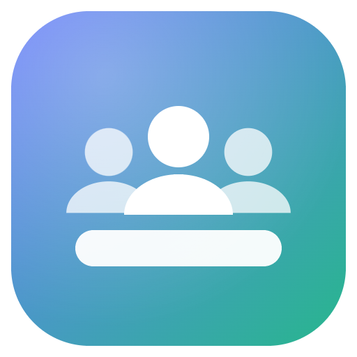

<p align="center">
  
</p>

<h1 align="center">Lobby</h1>

<p align="center">
  A private game launcher for you and your friends.<br/>
  One library for all your games, a friends list, lobbies with invites, and multiplayer that <b>never shares anyone's IP address</b>.
</p>

<p align="center">
  <a href="../../releases/latest"><b>⬇ Download the latest release</b></a> ·
  <a href="#-quick-start">Quick start</a> ·
  <a href="#-making-games-for-lobby">Make a game</a> ·
  <a href="#-building-from-source">Build from source</a>
</p>

---

## What is Lobby?

Lobby is like a small, self-hosted Steam for a group of friends:

- **🎮 Library**: add any game `.exe` (or scan a whole folder like `D:\Games`), launch it with one click, and
  track play time, launch options and favorites.
- **👥 Hub**: friends list with online / in-game status, friend requests, direct messages, lobbies,
  invites, ready-up and lobby chat.
- **🛡 Relay network**: play games that use "join by IP" or LAN with friends over the internet. Nobody ever
  sees anyone else's IP.
- **⭐ Lobby Certified games**: multiplayer games built for Lobby that open in their own window when the host
  presses Start. **Blast Arena** (a top-down shooter) comes built in, and anyone can make more.
- **⚙ Settings**: profile photo, server address, and the option to host your group's server right from the app.

There's no company server. **One person in your group hosts the Lobby server** (it's just a switch in
Settings), and everyone else connects to it.

---

## 🚀 Quick start

### 1. Download

Go to [**Releases**](../../releases/latest) and download one of these:

| File | Use it if… |
|---|---|
| `Lobby-Setup-x.y.z.exe` | You want a normal install with Start-menu and desktop shortcuts. **(Recommended)** |
| `Lobby-x.y.z-win-x64.zip` | You want a portable version. Unzip it anywhere and run `Lobby.exe`. |

Requirements: Windows 10 or 11, 64-bit.

> **"Windows protected your PC"?** Lobby isn't code-signed yet, so SmartScreen doesn't recognize it.
> Click **More info**, then **Run anyway**.

### 2. One person hosts the server

Pick **one** person in the group to host. Their PC needs to be on, with Lobby open, while people play.

1. Open Lobby. The login screen asks whether you're hosting or joining. Click **Start a server on this PC**.
2. Type a username and password, then click **Create account**.
3. To let friends connect **over the internet**:
   1. Install Cloudflare's free tunnel tool once. Open PowerShell and run:
      ```powershell
      winget install --id Cloudflare.cloudflared
      ```
   2. Restart Lobby, go to **Settings**, and click **Share over the internet**.
   3. Lobby shows an address like `wss://something-random.trycloudflare.com`. Click **Copy** and send it to
      your friends.

   The tunnel means friends connect through Cloudflare, so **your home IP stays hidden** and you don't need
   to open any ports on your router. The address **changes every time you start sharing**, so send the new
   one each session.
4. For a **LAN party** (everyone on the same network), also turn on **Allow LAN connections** and share the
   `ws://192.168.x.x:47420` address shown there.

> Accounts, friend lists and lobbies live on the host's PC. If a different person hosts, everyone makes new
> accounts on that server.

### 3. Everyone else joins

1. Install Lobby and open it.
2. On the login screen, under **Joining a friend?**, paste the address the host sent you and click **Connect**.
3. Type a username and password, then click **Create account**, choosing a username and a password (8+ characters).
4. Go to **Hub**, type the host's username under **Add friend**, and click **Add**. Once they accept,
   you're friends.

### 4. Play

**A Lobby Certified game (like Blast Arena):**
1. The host goes to **Library**, picks the game, and clicks **HOST LOBBY**, then **Create lobby**.
2. They click **Invite** next to friends. Friends get a pop-up and click **Join**.
3. The host clicks **Start game**, and the game opens in its own window for everyone.

**Your own .exe games (Terraria, Minecraft, Valheim, older LAN games…):**
1. Everyone adds the game to their **Library** with **+ Add** or **Scan**.
2. The host makes a lobby for it and starts hosting in the game as usual (or runs its dedicated server).
3. In the lobby's **Relay network** box, the host picks TCP or UDP, types the game's port (for example
   Terraria `7777`, Minecraft `25565`), and clicks **Share**.
4. Friends click **Connect** and Lobby gives them an address like `127.0.0.1:54970`. They type that into
   the game's **Join by IP** box.

Traffic goes *friend's game → friend's Lobby → server → host's Lobby → host's game*, so nobody's IP is exposed.

---

## 🛡 Privacy & security

Lobby was built so that friends playing together **never learn each other's IP address**.

- **Nobody connects directly to anyone else.** All chat, invites and game traffic go through the Lobby
  server. The server never includes an IP address in anything it sends to players.
- **Lobby Certified games are sandboxed with no internet access.** Web requests, WebSockets, remote
  images and WebRTC are all blocked. A game can only talk to other players through Lobby's relay, so even a
  game someone else made can't leak IPs.
- **Shared game ports stay local.** When you share a port, Lobby only ever connects to `127.0.0.1` on your
  own PC. Friends' connection points are only reachable from their own PC.
- **Lobbies are invite-only by default.** You can only invite friends, and invites expire after 15 minutes.
- **Passwords** are stored as salted scrypt hashes. Your **saved login** is encrypted with Windows DPAPI.
- **Profile photos** are re-encoded to a small PNG, which strips hidden metadata like location.
- **Launching games** uses only the `.exe` files you added, without a shell, so launch options can't run
  other commands.

**What it can't hide:** whoever **hosts the server** can see the IP addresses of the people connecting to
it, just as Steam or Discord can see yours. Only use a server hosted by someone you trust. With the
Cloudflare tunnel, the host's own IP is hidden from everyone.

---

## 🧩 Making games for Lobby

Lobby Certified games are regular HTML5/JavaScript games (plain JS, Phaser, PixiJS, Three.js, Godot or Unity
web exports…) packaged in a folder with a small `lobby-game.json` file. Lobby handles the lobby, the invites
and the networking. Your game just sends and receives messages.

- 📄 **[LOBBY-DEV-INSTRUCTIONS.md](LOBBY-DEV-INSTRUCTIONS.md)**: the full guide. It's written so you can
  **hand it to any AI** (or developer) and get a working Lobby game back.
- 🏁 **[examples/tap-race](examples/tap-race)**: a tiny complete multiplayer game to copy from.
- 💥 **[client/certified/blast-arena](client/certified/blast-arena)**: a real-time shooter with client-side
  prediction and smoothing.

**Installing a game:** in Lobby, go to **Library**, click **+** next to *Lobby Certified*, then choose
**Add game folder** or **Add .zip package**. Everyone in a lobby needs the same game installed.

---

## 🛠 Building from source

You need **[Node.js 22.13+](https://nodejs.org)** and Windows.

```powershell
git clone <this repo>
cd LOBBY\client
npm install
```

**Run it in development:**

```powershell
npm start                    # opens Lobby
npm run start:alt            # a second, separate account on the same PC (for testing invites/multiplayer)
```

Or double-click **`Start Lobby.bat`** in the repo root. It installs dependencies on first run, starts a
standalone dev server, and opens the app. **`Start Lobby (second account).bat`** opens a second account.

**Build the installer and portable zip:**

```powershell
cd client
npm run dist
```

This outputs `Lobby-Setup-<version>.exe` and `Lobby-<version>-win-x64.zip` in `client/dist/`. Bump `version`
in `client/package.json` before each release. To ship a build with your group's server address
pre-filled, create `client/lobby.config.json` before building:

```json
{ "defaultServer": "wss://your-server-address" }
```

**Run a standalone server** (for example on an always-on PC or a VPS, instead of hosting from the app):

```powershell
cd server
node src/index.js
# options (environment variables): LOBBY_PORT=47420  LOBBY_HOST=127.0.0.1  LOBBY_DATA=./data  LOBBY_TRUST_PROXY=1
```

Keep it on `127.0.0.1` and put TLS in front of it (for example `cloudflared tunnel --url http://localhost:47420`).
Never expose a plain `ws://` server to the internet.

**Tests:**

```powershell
# with a server running on 47420:
$env:NODE_PATH="client/node_modules"; node tests/e2e.js
```

`tests/e2e.js` registers three users and checks friends, invite-only lobbies, chat, the TCP/UDP relay, that
outsiders are blocked, and that **no IP address appears in any server message**.

### Project layout

```
LOBBY/
├─ client/                      The desktop app (Electron); this is what gets packaged
│  ├─ main.js                   windows, IPC, game sandbox, in-app server hosting
│  ├─ preload.js                the only bridge the UI gets (no Node access in the UI)
│  ├─ game-preload.js           the only bridge a game gets (window.lobbyGame)
│  ├─ src/                      connection, relay tunnels, library, game packages
│  ├─ src/server/               the Lobby server (runs inside the app or standalone)
│  ├─ certified/blast-arena/    built-in Lobby Certified game
│  └─ renderer/                 the UI (HTML/CSS/JS, no build step)
├─ server/src/index.js          standalone server launcher
├─ examples/tap-race/           minimal example game
├─ LOBBY-DEV-INSTRUCTIONS.md    game developer guide
├─ tests/                       end-to-end + UI test helpers
└─ tools/make-icons.js          regenerates the app icons
```

---

## ❓ Troubleshooting

| Problem | Fix |
|---|---|
| "Not connected to the Lobby server" | Hosts: click **Start a server on this PC** on the login screen. Friends: paste the host's latest address under **Joining a friend?**. Is the host's Lobby open with the server on? Shared tunnel addresses change every session, so ask the host for the current one. |
| "Port 47420 is already in use" when hosting | Another Lobby server is already running on this PC (for example `Start Lobby.bat`). Close it, or just connect to that one. |
| "Share over the internet" button is missing | Install cloudflared (`winget install --id Cloudflare.cloudflared`), then restart Lobby. |
| Friend's game can't find my server in its "LAN games" list | LAN *discovery* doesn't go through the relay. Use the game's **Join by IP** with the `127.0.0.1:port` address Lobby shows. |
| "You don't have that game installed" when the host starts | Get the game's `.zip` from the host and add it with **+** under *Lobby Certified*. |
| Play time looks too low | Some `.exe` files are launchers that start the real game and exit. Add the actual game `.exe` instead. |

## ⚠ Known limitations

- Windows only (for now).
- Direct messages aren't stored. Your friend has to be online to receive them.
- Lobbies reset if the server restarts (accounts and friends are kept).
- All relayed traffic goes through the host's internet connection, which is fine for a friend group.
- Not code-signed yet, so SmartScreen will warn on first run.

## 🗺 Roadmap

- **Lobby Link** for mods: let multiplayer mods (for example Cyberpunk co-op) use Lobby's invites and IP-safe relay
- Mod sets: sync the host's mod folder to everyone in the lobby before launching
- Virtual LAN mode (so games' "LAN games" lists work), voice chat, achievements, game artwork, auto-update
- A permanent server address option (named Cloudflare tunnel)
